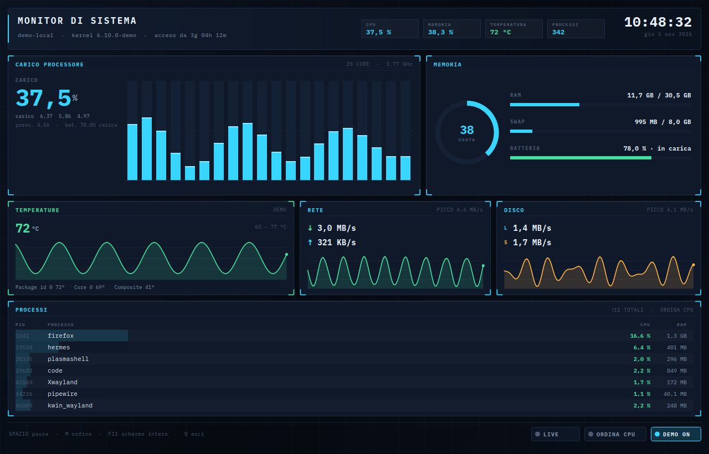

# Monitor di Sistema

Cruscotto di telemetria per Linux, C++20 / Qt 6, disegnato interamente a mano con
`QPainter`: nessun widget di sistema, nessuna immagine, nessuna dipendenza oltre a Qt.

Pagina: <https://cybernet.fun/monitor-sistema/> — la pagina pubblica è in `site/` qui dentro.
Licenza MIT.



Una sola finestra, sette pannelli:

1. **carico CPU** — percentuale totale, barre per ogni core (una per core, 20 su questa
   macchina), frequenza media, load 1/5/15, pressione CPU (`/proc/pressure/cpu`);
2. **memoria** — donut RAM, barre RAM/SWAP/BATTERIA con valori assoluti;
3. **temperature** — grafico degli ultimi 3 minuti con **auto-scala** (una macchina che vive
   a 76–96 °C su una scala fissa 0–100 sembra piatta) e i sensori in chiaro;
4. **rete** — ricezione/trasmissione istantanee e grafico del traffico;
5. **disco** — lettura/scrittura e grafico;
6. **processi** — i più pesanti per CPU o per RAM (si cambia con `M` o con l'interruttore),
   con PID, CPU normalizzata sul numero di core e RSS;
7. **testata e piè di pagina** — orologio, host, kernel, uptime, chip di riepilogo e
   interruttori cliccabili.

## Compilare e provare

```sh
cmake -B build -S .
cmake --build build -j"$(nproc)"
ctest --test-dir build --output-on-failure
./build/monitor-sistema
```

Installazione utente (binario + icona + voce di menu «Monitor di Sistema (cruscotto)», con
`Exec` assoluto generato all'installazione):

```sh
cmake --install build --prefix ~/.local
gtk-launch monitor-sistema
```

Il nome della voce è diverso da «Monitor di sistema» di KDE (`plasma-systemmonitor`) apposta:
due voci identiche nel launcher renderebbero impossibile capire quale si sta aprendo.

## Opzioni

| Opzione | Cosa fa |
|---|---|
| `--once`, `-o` | stampa un campione leggibile ed esce (headless, nessun display richiesto) |
| `--json`, `-j` | come `--once`, ma JSON |
| `--demo` | dati sintetici deterministici, nessuna lettura di `/proc` |
| `--interval <ms>` | intervallo di campionamento, default 200 (5 al secondo), minimo 20 (50 al secondo) |
| `--window <sec>` | secondi di storico nei grafici, default 60: più basso = grafici che scorrono più veloci |
| `--capture FILE` | salva un PNG della finestra ed esce |
| `--size WxH` | dimensione della finestra (default 1280x820) |
| `--wait MS` | attesa prima della cattura (default 900) |
| `--version`, `--help` | versione e aiuto |

Campionamento e disegno sono **disaccoppiati**: il timer campiona all'intervallo richiesto, il
ridisegno avviene al massimo ogni 100 ms (10 fps) e i processi vengono riscansionati una volta
al secondo. Così `--interval 40` (25 Hz) riempie i grafici a 25 campioni/s senza pagare 25
ridisegni al secondo: misurato 12,8 % di un core a 25 Hz, 4 % a 5 Hz (1280×820 su questo
portatile, scala 1,4×).

Diagnostica del disegno: `MON_PAINT_BENCH=1 ./monitor-sistema` stampa ogni 50 frame
`paint: X ms/frame, N frame, Y campioni/s`.

`--once`, `--json`, `--help` e `--version` costruiscono un `QCoreApplication`, non una
`QApplication`: funzionano su SSH, cron e CI senza display.

## Tasti e interruttori

| Comando | Effetto |
|---|---|
| `Spazio` / interruttore `LIVE` | mette in pausa o riprende il campionamento |
| `M` / interruttore `ORDINA CPU·MEM` | ordina i processi per CPU o per RAM |
| `D` / interruttore `DEMO` | dati sintetici on/off |
| `F11` | schermo intero |
| `Esc` | esce dallo schermo intero, poi chiude |
| `Q` | chiude |

## Struttura

| Pezzo | Responsabilità |
|---|---|
| `src/core/telemetry.*` | legge `/proc` e `/sys`, calcola i delta; niente Qt Widgets |
| `src/core/format.*` | numeri all'italiana, byte, velocità, durate |
| `src/ui/dashboard.*` | timer, campionamento, `buildLayout()`, hit-test, input |
| `src/ui/dashboard_paint.cpp` | solo disegno: pannelli, barre, sparkline, chip, interruttori |
| `src/main.cpp` | GUI, modalità headless, cattura |

`buildLayout()` produce **un** `struct Layout` che disegno e hit-test leggono entrambi: un
resize intermedio non può più far finire il click sul rettangolo sbagliato.

Il sampler accetta una radice finta di `/proc` e `/sys`; le fixture dei test stanno in una
`QTemporaryDir` e la suite non dipende dalla macchina che la esegue.

## Sorgenti

| Dato | Sorgente | Nota |
|---|---|---|
| CPU, per core | `/proc/stat` | due campioni: il primo non ha delta e vale `—` |
| frequenza | `cpuinfo` → `cpu MHz` (media), fallback `cpufreq` | — |
| memoria | `/proc/meminfo` | usa `MemAvailable`, non `MemFree` |
| rete | `/proc/net/dev` | `lo`, `docker*`, `br-*`, `veth*`, `virbr*`, `zt*`, `tun*`… esclusi |
| disco | `/proc/diskstats` | solo dischi interi: le partizioni contano due volte |
| temperature | `/sys/class/hwmon/*/temp*_input` | milli-°C, etichetta per sensore |
| batteria | `/sys/class/power_supply/*` | `type` = `Battery` / `Mains` |
| processi | `/proc/<pid>/stat` | tick con `sysconf(_SC_CLK_TCK)`, `comm` tagliato all'ultima `)` |

I file di `/proc` hanno `st_size` 0: si leggono con `readAll()`, mai con `QTextStream`
(`atEnd()` diventa vero subito e i pannelli restano vuoti senza errori).

## Test

```sh
ctest --test-dir build --output-on-failure
```

- `test_core` — fixture completa di `/proc` + `/sys`: CPU 20 % (totale e per core), memoria
  25 %, rete solo su `eth0`, disco solo su `nvme0n1` (partizione esclusa), temperature
  ordinate, batteria/alimentazione, `comm` con spazi e parentesi, CPU per processo
  normalizzata sui core; più la scansione processi disaccoppiata (a 60 ms la lista non si
  riscansiona e viene riusata) e la formattazione italiana.
- `test_dashboard` — rendering offscreen della demo (immagine non piatta, ciano presente,
  layout non sovrapposto), click sui rettangoli veri degli interruttori, `Spazio`, resize
  estremo 360×260 → 2400×1400, e capacità della cronologia al variare di intervallo e
  finestra (`--interval 40` + 60 s → 1500 punti).

## Limiti noti

- Le temperature sono quelle che il kernel espone: `acpitz` può riportare un valore fisso
  (qui 96 °C) che non è la temperatura reale della CPU. Le soglie di colore sono tarate su
  questa macchina (ambra ≥ 96 °C, rosso ≥ 99 °C): su un'altra vanno riviste.
- La media delle frequenze viene da `cpuinfo`, che è il valore istantaneo del primo core per
  alcuni kernel: è indicativa, non un dato per core.
- Nessuna persistenza: storico in memoria (3 minuti a 1 Hz), nessun file di stato.
